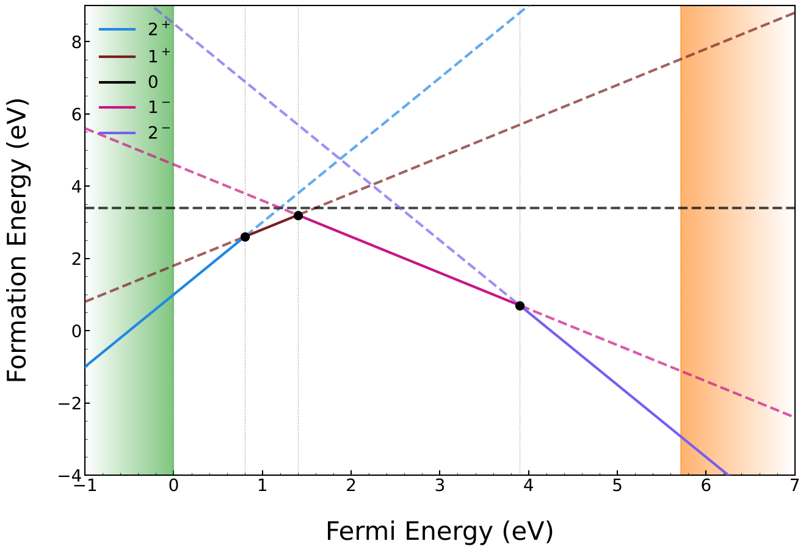
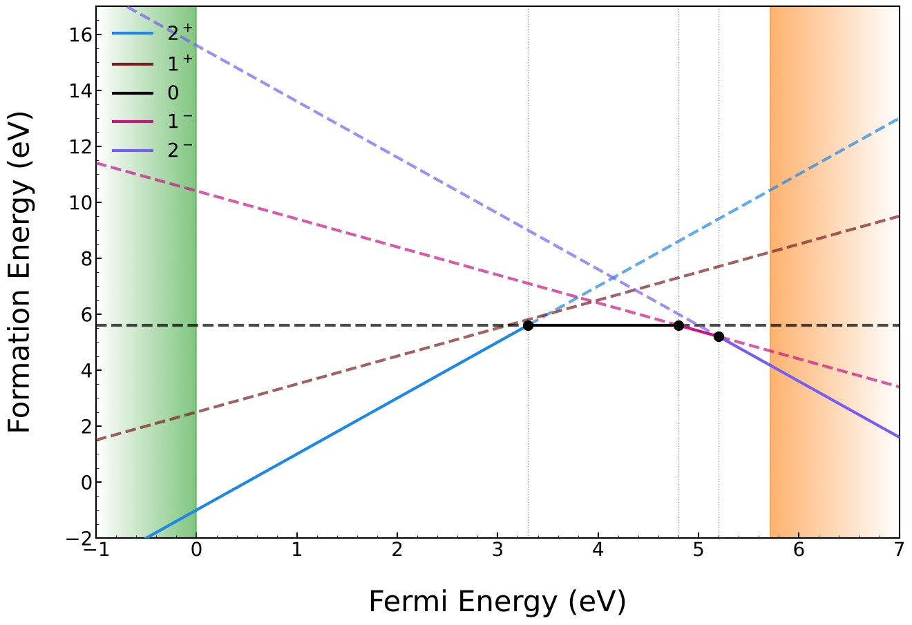
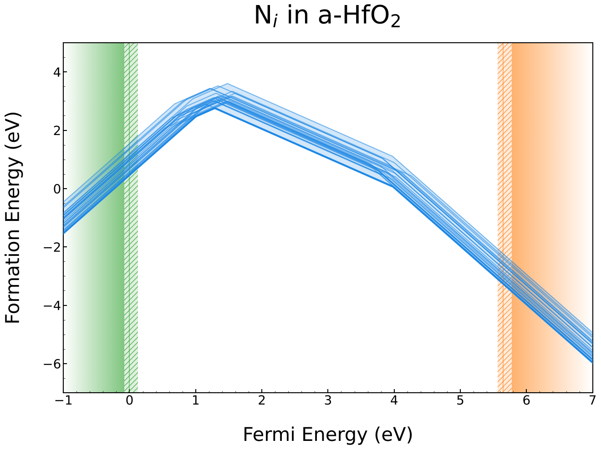
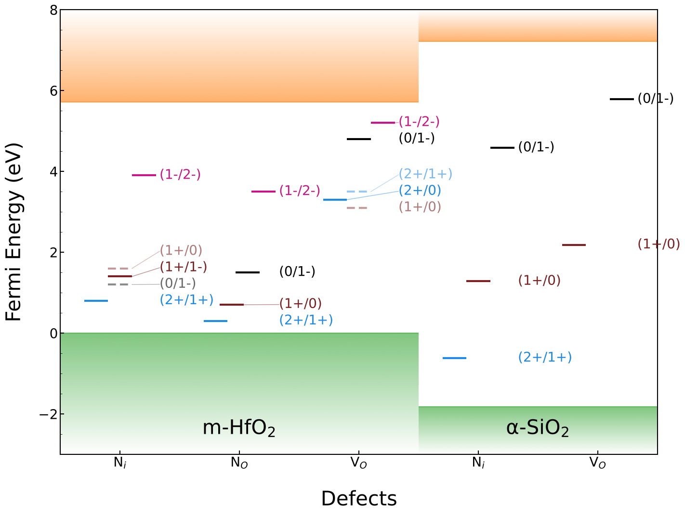
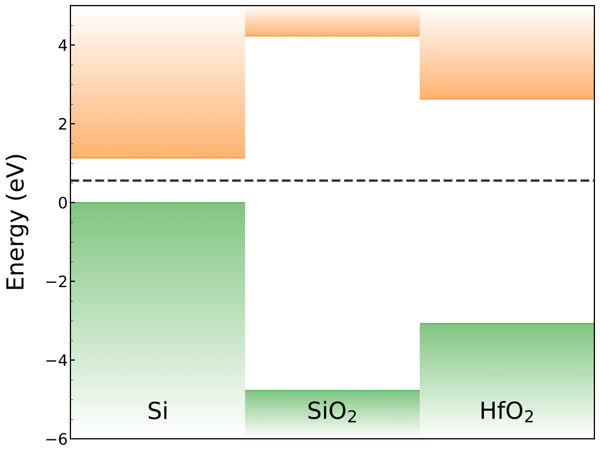
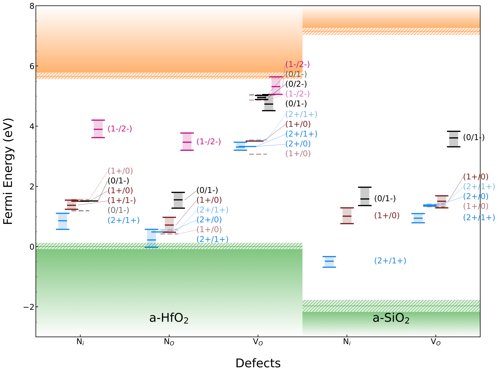
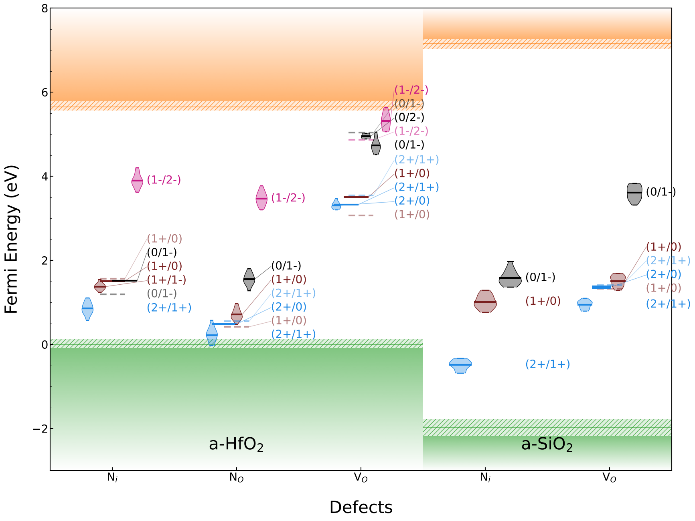
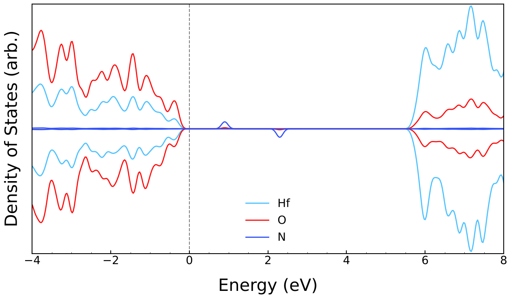
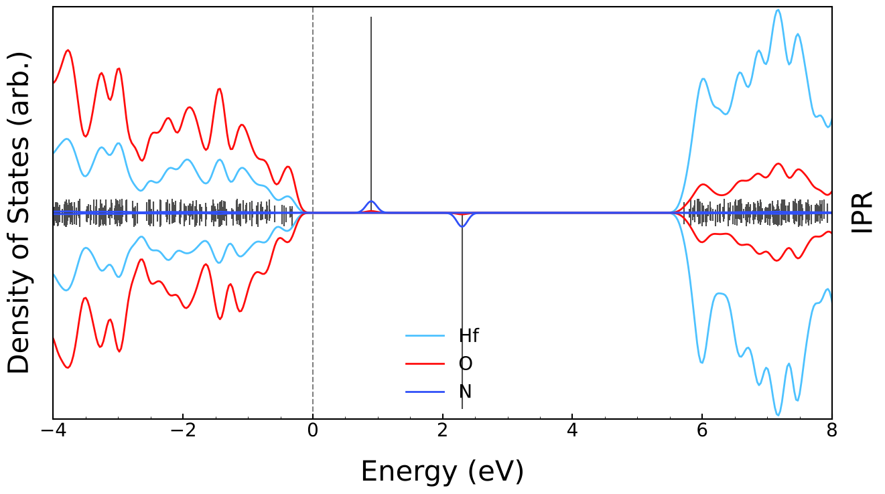
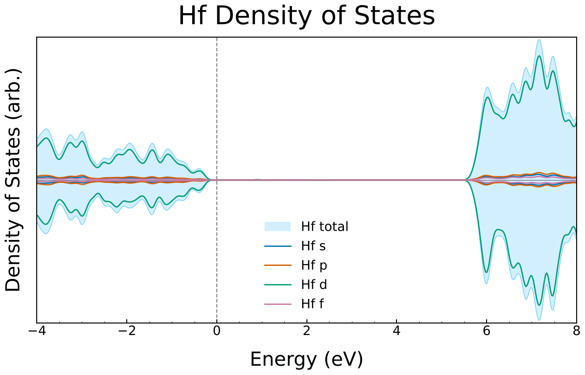

# CP2K Utils

Python tools for analysing and plotting [CP2K](https://www.cp2k.org/) output, focused on point-defect studies.

Each feature has an example notebook in [`example_scripts/`](example_scripts/) with every input and option explained. This page is an overview.

| Feature | Function | Example |
|---|---|---|
| Charge transition level (CTL) diagrams for a single host | `ctl.plot_ctl` | [plot_ctl.ipynb](example_scripts/plot_ctl.ipynb) |
| CTL spread over many sites/cells (amorphous materials) | `ctl.plot_range_ctl` | [plot_range_ctl.ipynb](example_scripts/plot_range_ctl.ipynb) |
| Band-aligned CTL summary over several defects and materials | `ctl.plot_multi_mat_ctl` | [plot_multi_mat_ctl.ipynb](example_scripts/plot_multi_mat_ctl.ipynb) |
| Band offset diagrams (no defects needed) | `ctl.plot_multi_mat_ctl` | [plot_multi_mat_ctl.ipynb](example_scripts/plot_multi_mat_ctl.ipynb) (section 5) |
| Projected DOS and IPR plots | `new_pdos.PDOSPlotter` | [pdos_plot.ipynb](example_scripts/pdos_plot.ipynb) |
| XYZ → CIF conversion | `structures.xyz_to_cif`, CLI `xyz-to-cif` | [below](#xyz-to-cif) |
| Interstitial site generation from a density cube (WIP) | `defect_gen.int_gen` | [below](#interstitial-site-generator-wip) |

## Installation

The modules are imported as `cp2k_utils.<module>`, so the folder **that contains** this repository needs to be on your Python path:

```bash
git clone https://github.com/isaacmackley/cp2k_utils.git
```

```bash
export PYTHONPATH="$PWD:$PYTHONPATH"   # run from the folder you cloned into
```

Dependencies: `numpy`, `matplotlib`, and `pymatgen` (only for `structures` and `defect_gen`).

---

## Charge transition levels (`cp2k_utils.ctl`)

The inputs are a few small dataclasses. They are shared by all three plotting functions, and any of them can be styled with the same `StyleOptions`:

| Class | Represents |
|---|---|
| `Defect` | One charge state of one defect. Holds the energy, chemical potentials, charge correction, defect type and site. `cell_id`, `site_id` and `material` are optional and used for amorphous / multi-material data. |
| `Cell` | One calculation cell: VBM, CBM, pristine energy and an optional potential alignment |
| `Material` | A host material, made of one or more `Cell`s, with a band offset |
| `CTL` | A transition level from outside the package, e.g. from the literature |
| `FermiLevel` | A horizontal Fermi level guide |
| `StyleOptions` | Plot styling: fonts, limits, legend, labels, band shading… |

Defects can be written directly in Python or loaded from a spreadsheet with `load_defects_csv` (`write_sample_csv` writes a template). Energies are in Ha, except the charge correction, which is in eV.

Transition levels are the exact crossings of the lowest-energy formation energy lines. When a charge state is skipped (negative-U), the transitions through the skipped state are also reported as *bypassed*. In amorphous data, each site is computed against its own cell's energy and VBM before any averaging. A site only counts towards a transition's distribution if the transition is a real level at that site.

In the amorphous plots, the VB and CB shading is solid up to the band edge every cell agrees on. A **hatched strip** shows the range of the band edge across cells.

### `plot_ctl`: single host

Formation energy vs Fermi level for each defect. Each line is solid where that charge state is the most stable and dashed elsewhere. Transition levels are marked, and the VB and CB are shaded. It returns the transition levels and can also export the lines to CSV.

 

### `plot_range_ctl`: one defect over many sites

The lowest-energy line of every site/cell for one defect type. The band between the lowest and highest is shaded, the overall lowest is drawn in bold, and the hatched strips show the cell-to-cell spread of the VBM and CBM.



### `plot_multi_mat_ctl`: band-aligned summary

The transition levels of several defects in one or more materials, placed using the materials' band offsets:
- A single site gives a single line per transition. Many sites give a distribution, drawn as a min / mean / max bar, a violin (density of the values) or a strip (every site's level), set by `style_kind`.
- Labels are spread out automatically so they don't overlap.
- Optional extras: bypassed (negative-U) levels, Fermi level lines, and precomputed `CTL`s.

With no defects it draws just the band offset diagram.

 
 

---

## PDOS (`cp2k_utils.new_pdos`)

`PDOSPlotter` reads the CP2K `.pdos` files in the current folder and applies Gaussian smearing. Spin-polarised and non-polarised runs are both supported. It plots:
- per-element plots: the element total shaded in its Jmol colour, with s / p / d / f lines in fixed colours shared by all elements,
- the total for each element, in Jmol colours,
- the total with the IPR of each state on a second axis. Spin-up sticks point up and spin-down sticks point down, like the DOS.

`smeared_pdos` returns the smeared data without plotting. The older function interface (`pdos_plot`, `ipr_pdos_plot`) is still in `cp2k_utils.pdos`.

 


---

## XYZ to CIF

`cp2k_utils.structures.xyz_to_cif` converts an XYZ file to a CIF, given the cell parameters (Å, degrees). It is also available from the command line:

```bash
xyz-to-cif input.xyz a b c alpha beta gamma output.cif
```

## Interstitial site generator (WIP)

`cp2k_utils.defect_gen.int_gen(cube_file, specie, output_filename, int_no=10)` runs pymatgen's `ChargeInterstitialGenerator` on a CP2K density cube file. It writes one CIF per candidate interstitial site, plus one CIF with every site.

---

<sub>The images above come from the example notebooks. **All of the data behind them are synthetic**: made-up energies, band edges and PDOS generated by the scripts in [`example_scripts/data/`](example_scripts/README.md#example-data), not real calculations. The material names are only there for readability, and because the data are invented some plots may look odd.</sub>
